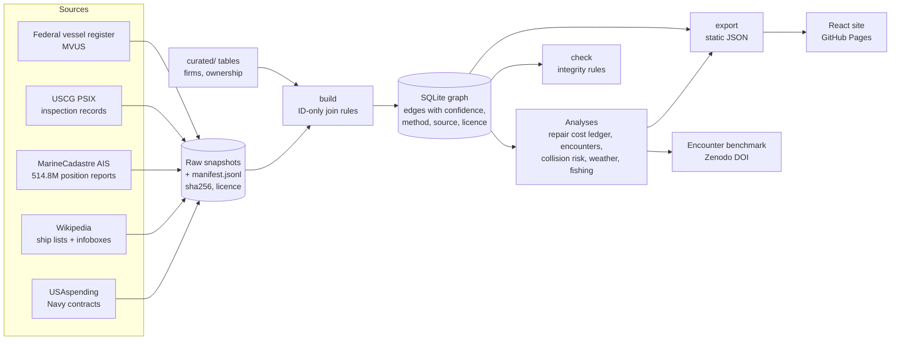

# HarborLedger

[](https://github.com/maxsondcook/HarborLedger/actions/workflows/test.yml)
[](https://doi.org/10.5281/zenodo.24047861)
[](LICENSE)
[](LICENSE-DATA.md)

**Five public maritime sources that share no common key, resolved into one graph of vessels. Every link
records the rule that made it, a confidence, its evidence and its licence.**

**Live site:** https://maxsondcook.github.io/HarborLedger/

## The question

Navy repair contracts, Wikipedia ship articles, AIS ship tracks, Coast Guard inspection records and
the federal vessel register each describe California's working waterfront. None of them shares an
ID with the others. **How reliably can they be joined using only stable identifiers, and what does
the joined data make possible?**

Joins use call sign, IMO, MMSI or official number. A name can confirm a match but never makes one.
Conflicting IDs are never linked. Each join rule's accuracy is measured on samples labelled by hand
after the rule was fixed, against targets set before testing.

## How it fits together



## Headline results

Every number below has a 95% confidence interval. The full table, with the interval method behind each
number, is in **[docs/RESULTS.md](docs/RESULTS.md)**.

| Result | Value | 95% CI |
|---|---|---|
| AIS → Coast Guard matching: precision on 180 records labelled by hand | 100% | 97.9 – 100% |
| AIS → Coast Guard matching: share of 4,922 vessels auto-merged | 83.6% | 82.6 – 84.7% |
| Collision-risk model: AUC gain over a CPA/TCPA-only baseline (trained on 2024, tested on 2025) | +0.122 | +0.117 – +0.127 (resampled by day) |
| Navy repair cost ledger: forecast error cut vs. the overall median at day 180 | 49.9% | 40.5 – 59.9% |

What didn't work is reported too:
- The cost model is **not** significantly better than carrying forward the growth seen so far.
- The hull-extraction sample (n = 30) is too small to confirm its 95% precision target.
- A schedule-slip label turned out to encode how each contracting office words its paperwork, so it was withdrawn.
- Limitations are listed in the [build log](docs/BUILD_LOG.md#known-gaps).

## Quickstart

Requires Python 3.13 and Node 22.

```bash
python3 -m pip install -r requirements-dev.txt
python3 -I -m pytest tests -q          # 61 tests; needs no raw data
npm --prefix site ci && npm --prefix site run dev   # site at http://localhost:5173/HarborLedger/
```

The site builds from the committed JSON in `site/public/data/`, so you don't need the database to work on it.

### Rebuilding the data

Raw data is not committed (about 10 GB even after filtering AIS to California). The fetch steps are throttled, cached and
partly manual, and each source's terms are in the [data-source register](docs/data-sources.md).

```bash
python3 -I run.py pull-txns data/raw/usaspending/awards/navy_336611_US_ge5m_FY15-26.json
python3 -I run.py pull-ais 2024-01-01 2025-12-31
python3 -I run.py match-psix
python3 -I run.py build && python3 -I run.py pull-wiki-ids   # wiki IDs need a built graph
python3 -I run.py forecast-fetch
```

Then rebuild everything else in dependency order with one command:

```bash
python3 -I run.py all            # tug-activity -> build -> growth -> analyses -> export -> results -> check
python3 -I run.py all --list     # show the 15 steps
python3 -I run.py all --from export
```

`run.py check` checks the graph's rules after each build: edge confidence in [0, 1], a licence and
method on every edge, no orphan edges, stable-ID join methods only, and site counts that match
the database. It exits non-zero on any error. The rules and tables are documented in
[docs/schema.md](docs/schema.md).

## Repository layout

| Path | Contents |
|---|---|
| `harborledger/` | Pipeline modules: sources (`usaspending`, `ais`, `psix`, `mvus`, `bridge`, `ocean`), `build`, analyses (`ledger`, `model`, `encounters`, `collision`, `weather`, `forecast`, `fishing`, `activity`), `export`, `checks`, `results` |
| `run.py` | Command-line entry point (`python3 -I run.py` lists commands) |
| `curated/` | Hand-maintained tables: firms, UEI → firm, dated ownership, extra hulls |
| `eval/` | Hand-labelled samples and every result file |
| `tests/` | Unit tests: join rules, CPA/TCPA maths, PSIX gating, ledger labels, integrity checks, export shape, fetch policy |
| `site/` | Vite + React + TypeScript site (HashRouter, static JSON) |
| `docs/` | [Case study](docs/CASE_STUDY.md), [results](docs/RESULTS.md), [schema](docs/schema.md), [findings](docs/findings/), [benchmark data card](docs/benchmark/README.md), [data-source register](docs/data-sources.md), [build log](docs/BUILD_LOG.md) |

## Write-ups

- [Collision alerts against a real-traffic baseline](docs/findings/collision-alerts-real-traffic-baseline.md)
- [Service boats inflate near-miss counts](docs/findings/service-boats-inflate-near-miss-counts.md)
- [Harbor tugs are busier than the inventory says](docs/findings/harbor-tugs-busier-than-inventory.md)
- [Weather adds little to coastal trip time](docs/findings/weather-adds-little-to-coastal-trips.md)

## Data collection rules

Public data only. Every request identifies the project in its user agent, is throttled and cached.
Blocks are never bypassed and SSL checks are never disabled; `tests/test_fetch_policy.py` enforces this.
Owner names are published only for organisations, and owner addresses are never kept. Global Fishing
Watch, OpenSanctions and Equasis data are excluded from anything published.

## Licence and citation

Code is MIT ([LICENSE](LICENSE)). Derived data is CC BY 4.0. Wikipedia-derived rows stay CC BY-SA 4.0
([LICENSE-DATA.md](LICENSE-DATA.md)). To cite the project, use [CITATION.cff](CITATION.cff); to cite the
benchmark, use [10.5281/zenodo.24047861](https://doi.org/10.5281/zenodo.24047861).
